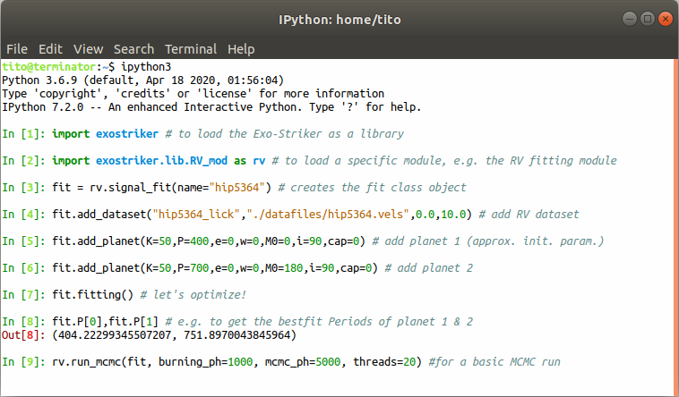

<!-- **T**ransit and **R**adial velocity **I**nteractive **F**itting tool for **O**rbital analysis and **N**-body simulations: -->
**The Exo-Striker — version 0.97.1**

  

 
The Exo-Striker analyzes exoplanet orbitals, performs N-body simulations, and models the RV stellar reflex motion caused by dynamically interacting planets in multi-planetary systems. It offers a broad range of tools for detailed analysis of transit and Doppler data, including power spectrum analysis for Doppler and transit data; Keplerian and dynamical modeling of multi-planet systems; MCMC and nested sampling; Gaussian Processes modeling; and a long-term stability check of multi-planet systems. The Exo-Striker can also perform Mean Motion Resonance (MMR) analysis, create fast fully interactive plots, and export ready-to-use LaTeX tables with best-fit parameters, errors, and statistics. It combines Fortran efficiency and Python flexibility and is cross-platform compatible (MAC OS, Linux, Windows). 

 

  

**Documentation, Instructions, and Tutorials**

* [Python scripts and Jupyter notebooks](examples/README.md) for HIP 5364, 51 Peg and WASP-6, provided by Trifon Trifonov with the aid of CODEX; use with caution.

* (Work in progress) documentation is available at [https://exostriker-manual.readthedocs.io](https://exostriker-manual.readthedocs.io/en/latest/).

**Changes in 0.97.1**

* Joint RV–activity Gaussian processes fit selected activity indicators together with RVs in time, using the existing kernel parameters and priors. Per-index responses, offsets and jitters are configured in the GUI; derivative responses are available for supported kernels.
* An independent magnetic-cycle sine model couples selected activity indices to the RVs through a shared period, with separate amplitudes and optional per-index phase offsets. It runs outside celerite and does not occupy a planet slot.
* Activity plots now use the RV/transit Size, Alpha, Symbol and Color controls. Time-series and GLS residual views, crosshairs, legends, correlation plot options and display-name editing are available. Small activity values and uncertainties remain visible in scientific notation.
* Native Fortran LM/Simplex options expose iteration/evaluation budgets, tolerances and step controls, saved with the fit. Supported Gaussian and Jeffreys priors enter inference; reported lnL remains the data likelihood without prior density.
* Hipparcos and Gaia have independent Fit checkboxes for ExTRA: use either mission or both. Stellar-density transit parameterization uses the stellar-density bounds/priors and matching parameter labels.
* GLS/MLP adoption transfers the best sine period, amplitude and phase into the first free planet slot without optimizing. Detailed information windows retain useful sizing.
* Exoplanet-only activity coupling, magnetic-cycle and related controls stay hidden under `-QSO`; shared test-data plotting remains available.
* Static GUI changes are maintained in `exostriker/lib/UI/es.ui` and regenerated with `cd exostriker/lib/UI && bash command`. See [GUI development](docs/GUI_DEVELOPMENT.md) and the [manual source](exostriker-manual/README.md).

**Changes in 0.96.2**

* RV-only Fortran fits support configurable primary and secondary LM/Simplex minimizers, with covariance-based Simplex uncertainty estimates for Keplerian and dynamical models.
* SciPy TNC and Nelder–Mead have automatic settings and reset controls. Nelder–Mead also supports a parameter-scaled initial simplex, adaptive coefficients, and jitter boundary recovery.
* Priors can be updated from fitted values and uncertainties, with optional rounding, physical bounds, and synchronization with the GUI.
* LaTeX parameter and prior tables use consistent fit-specific labels and units. Parameter tables automatically distinguish symmetric and asymmetric errors; prior tables include Gaussian truncation bounds.
* Fit and integration timing reports identify the minimizer or backend and display five decimal places.

**Developer**

* Trifon Trifonov, MPIA Heidelberg.
* with contributions by Matheus J. Castro, Deyan P. Mihaylov, Jakub Morawski, Mathias Zechmeister, Man Hoi Lee, Stefan Dreizler, Grigorii Smirnov-Pinchukov, Stephan Stock, Jonas Kemmer, Harry Psarakis, Tom Schiwy, and Desislava Antonova.

**What works**:

* RV signal and alias search: via GLS periodogram & maximum lnL periodogram (MLP).
* Transit signal search (via "TLS").
* Interactive transit photometry detrending (via "wotan").
* Keplerian and Dynamical modeling of RV & Transit photometry exoplanet data.
* Joint RVs + Transit + GPs best-fit optimization (internal Fortran Simplex and L-M minimizers, or many more via "SciPyOp").
* Joint RVs + Transit + GPs MCMC/Nested Sampling (via "emcee" & "dynesty") 
* TTVs extraction (outside of the GUI, contact me for instructions!).
* TTVs and/or joint TTVs + RVs analysis.
* Photodynammical modeling of transit light curves.
* GP modeling (via "celerite"), including Python joint RV–activity conditioning and an independent magnetic-cycle sine mean.
* Linear models for detrending ground-based transit photometry.
* Activity index signal search via GLS periodogram, including model/mean residual periodograms.
* RVs vs. Activity time-series correlation analysis/plots.
* RV auto-fit (RV automated planet-finder algorithm).
* Interactive data binning, clipping, outlier removal, etc.
* Fit for apsidal orbital precession, or apply General Relativity (GR) precession. 
* Instant online access to the "RVBank" database (over 252,000 RVs and activity indices of about 3000 HARPS stars & over 64,000 RVs and activity indices of about 1700 HIRES stars !!!).
* Instant AMD stability check for multiple planetary systems (including during optimization or MCMC/Nested Sampling).
* Long-term stability check of multiple planetary systems using SyMBA, MVS, and MVS with a GR precession.
* Fully interactive, super-fast, high-quality, exportable plots.
* Handy "cornerplot" GUI control.
* Import/Export of work sessions and multi-sessions. 
* Export plots to a matplotlib window for further customization.
* Export ready-to-use LaTeX tables with best-fit parameters, errors, and statistics. 
* Handy text editor and calculator tools.
* Multi-platform: It works on MAC OS (10.6+), Linux (Suse, Mint, Ubuntu, etc.) and Windows 10/11.
* Integrated Bash shell (Linux only).
* Integrated Jupyter shell.
* Integrated AI chat via the OpenAI Responses API, with current model selection, conversation history, and reasoning controls (an OpenAI API key is required).
* Importable as a standard python library (i.e., "import exostriker").
* Print the GUI screen into a .jpeg/.png image (useful for sharing quick results, just like the image above).
* Direct import of TESS & K2 *lc.fits, and CHEOPS *SCI_COR*.fits files.
* Combined modeling with Hipparcos, Gaia and imaging astrometry through ExTRA, with independent Hipparcos/Gaia dataset selection.
* Larger arsenal of N-body/dynamical simulation/analysis tools ("REBOUND" is included). 
<!-- * Internal TTV and photo-dynamical modeling (i.e. the external "TTVFast" will become a secondary option).-->

Feedback and help in further development will be highly appreciated!
A wish list with your favorite tools and methods to be implemented is also welcome!

Just open an "Issue" on GitHub or send a PM to trifonov@mpia.de.

**Installation**
 
Python 3.10 or newer is required. Use a separate environment instead of replacing your system Python.

Apart from Python3.10+ make sure you have '**gcc**', '**gfortran**', and '**csh**',
which will be needed for compiling some of the important binaries! Some systems 
do not have the **python3.1X-dev** so you make sure you have it, in case the Exo-Striker
does not want to compile!

**See [README_install.md](README_install.md)** for further instructions.

**Usage**

* To load the GUI, on a bash shell type: 

$ exostriker (in case of system-wide install, see above)

* or just do:

$ python3.11 -m exostriker (inside of the git clone directory, see above, and also [README_install.md](README_install.md))
 

* If you want to use the library on the Python shell/script

In [1]: import exostriker

* or e.g., to load the RV routines:

In [1]: import exostriker.lib.RV_mod as rv
    
    
* Remember! Every button/action of the GUI is a wrapper of a convenient Python routine. Thus scripting is very easy:

  

 
(However, one must be familiar with the functions and the 'fit' object... 
A manual is planned but not available at the moment.)

**Credit**

If you made use of The Exo-Striker for your paper, I would appreciate it if you gave credit to it.
As it is unlikely that I will find time to write a refereed paper on The Exo-Striker soon, please cite the tool with its ASCL ID ascl:1906.004 (see https://ascl.net/1906.004).    
 
The Exo-Striker relies on many open-source packages, which if you had made use of (some of) them while working with the tool, 
you should acknowledge too. (It is your responsibility to find the correct references in the literature):    

* The interactive plotting is done with a custom version of the "pyqtgraph": 

http://www.pyqtgraph.org/

* "GLS" and "MLP" periodograms are taken from Mathias Zechmeister's repo: 

https://github.com/mzechmeister/python

* "TLS" and "wotan" are taken from: 

https://github.com/hippke/tls

https://github.com/hippke/wotan

* The transit modeling is done with "batman":
 
https://github.com/lkreidberg/batman

* MCMC sampling is done with "emcee": 

https://github.com/dfm/emcee

* Nested Sampling is done with "dynesty": 

https://github.com/joshspeagle/dynesty

* TTV models are adopted from "TTVfast-python":

https://github.com/mindriot101/ttvfast-python

* The "Text editor" used in the tool is a hack between "Megasolid Idiom" 
and "PyEdit2":

https://github.com/mfitzp/15-minute-apps/tree/master/wordprocessor

https://github.com/Axel-Erfurt/PyEdit2

* N-body tests are performed using a custom version of the "Swift" N-body library,
modified by Man Hoi Lee (HKU) and Trifon Trifonov (MPIA).

https://www.boulder.swri.edu/~hal/swift.html

* Additionally, the Exo-Striker uses many "standard" Python libraries like 
"PyQt5/PyQt6", "matplotlib", "numpy", "scipy", "dill", "Jupyter", "qtconsole",
and more.

* The Exo-Striker project was inspired by the Systemic project.

http://www.stefanom.org/systemic/

**Scientific papers which one way or another made use of the Exo-Striker (to my knowledge):**

 
[Check in ADS](https://ui.adsabs.harvard.edu/abs/2019ascl.soft06004T/citations)
